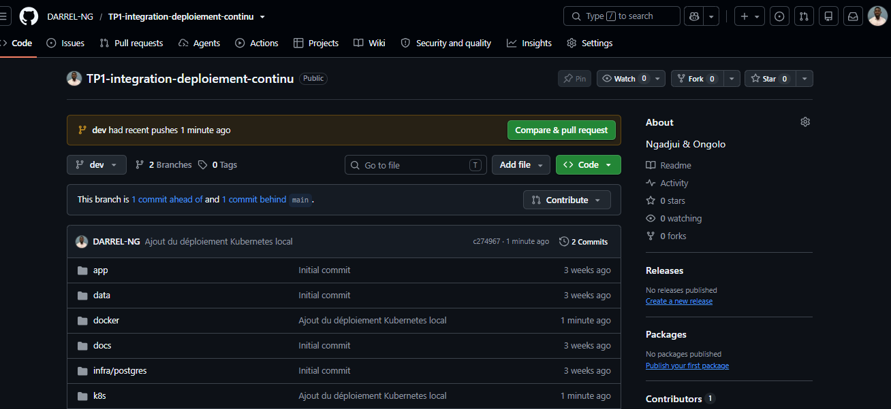
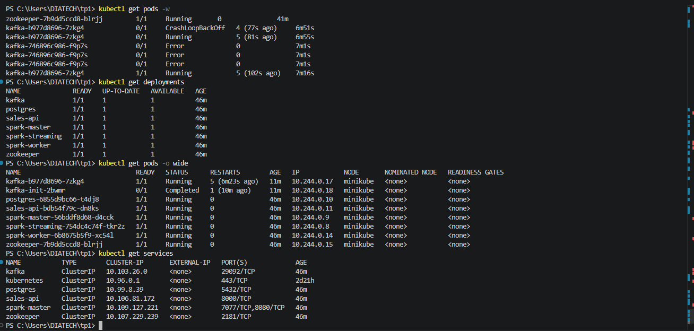
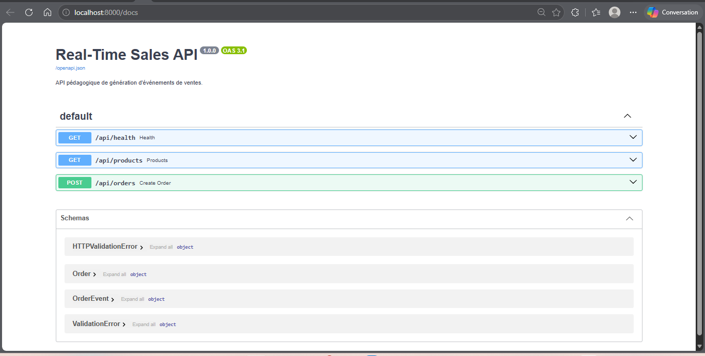
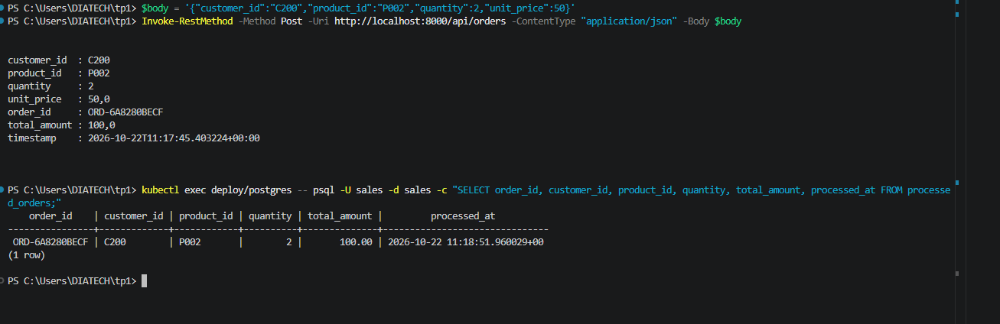
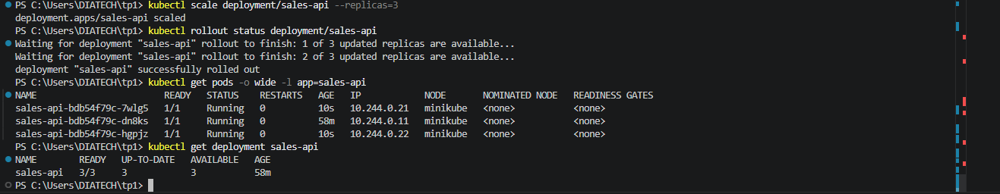
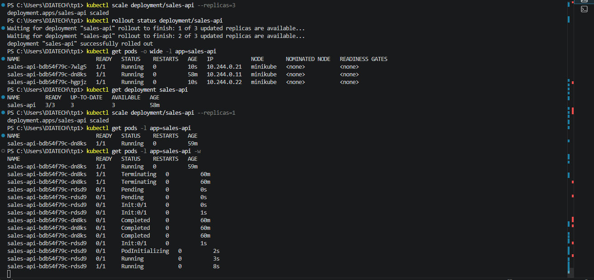

# Déploiement Kubernetes local (Minikube)

Version Kubernetes de la plateforme Real-Time Sales (Jenkins et SonarQube hors périmètre).

| Composant | Objets | Service (DNS interne) |
|---|---|---|
| API FastAPI | Deployment `sales-api` | `sales-api:8000` |
| PostgreSQL | Deployment + PVC `postgres-data` | `postgres:5432` |
| Zookeeper | Deployment | `zookeeper:2181` |
| Kafka | Deployment + Job `kafka-init` (topic `sales.orders`) | `kafka:29092` |
| Spark | Deployments `spark-master`, `spark-worker`, `spark-streaming` | `spark-master:7077` |
| Configuration | ConfigMaps `sales-config`, `postgres-init` ; Secret `postgres-secret` (hors Git) | - |

## Lancer

```bash
docker build -t sales-api:tp3 -f docker/api/Dockerfile .
docker build -t sales-spark:tp3 -f docker/spark/Dockerfile.k8s .
minikube image load sales-api:tp3
minikube image load sales-spark:tp3
minikube image load spark:3.5.3-python3

kubectl create secret generic postgres-secret --from-literal=POSTGRES_PASSWORD=<mot_de_passe>
kubectl apply -f k8s/
kubectl port-forward service/sales-api 8000:8000
```

## Adaptations par rapport à Docker Compose

- Les noms de Services reprennent ceux de Compose (`kafka`, `postgres`, `zookeeper`, `spark-master`) : les variables d'environnement restent inchangées.
- `enableServiceLinks: false` : sinon Kubernetes injecte `KAFKA_PORT`, `SPARK_MASTER_PORT`... qui perturbent les images.
- `depends_on` -> `initContainers` qui attendent que Kafka, Postgres et Spark soient joignables.
- `kafka-init` -> `Job` ; `init.sql` -> ConfigMap montée dans `/docker-entrypoint-initdb.d`.
- Service `kafka` avec `publishNotReadyAddresses: true` : Kafka se contacte lui-même via `kafka:29092` avant d'être Ready (sinon blocage).
- Kafka en stratégie `Recreate` : deux brokers avec le même `broker.id` ne peuvent pas coexister pendant une mise à jour.
- Spark : image officielle `spark:3.5.3-python3` (multi-arch) au lieu de `treeverse/bitnami-spark:3.5`, disponible uniquement en arm64 ; master et worker lancés avec `spark-class`, image applicative construite avec `docker/spark/Dockerfile.k8s`.
- Driver Spark : `spark.driver.host=$(POD_IP)` pour que les executors puissent le joindre.
- Mot de passe Postgres dans un Secret créé par `kubectl`, jamais dans Git.
- Ressources Spark réduites (1 cœur, 1 Go) pour tenir dans Minikube.

## Résultats observés

- **Flux Data** : `POST /api/orders` -> commande `ORD-B1F3DE4E13` (300,00) publiée dans Kafka, traitée par Spark et retrouvée dans `processed_orders` environ 27 s plus tard.
- **Mise à l'échelle** : `kubectl scale --replicas=3` crée 2 Pods supplémentaires (IP distinctes), le Deployment passe à `3/3`, puis revient à 1 réplica.
- **Suppression d'un Pod** : après `kubectl delete pod sales-api-bdb54f79c-dn8ks`, le ReplicaSet constate qu'il manque un réplica par rapport à l'état souhaité (`replicas: 1`) et crée immédiatement `sales-api-bdb54f79c-rdsd9`, qui passe `Running` en 8 s. Le Service `sales-api` redirige automatiquement le trafic vers le nouveau Pod grâce au label `app: sales-api`, sans intervention manuelle.

## Preuves

| Livrable | Capture |
|---|---|
| Manifestes sur la branche `dev` |  |
| `get pods` / `get deployments` / `get services` |  |
| API accessible via le Service (Swagger) |  |
| Flux API -> Kafka -> Spark -> PostgreSQL |  |
| Mise à l'échelle à 3 réplicas |  |
| Suppression d'un Pod et recréation automatique |  |
